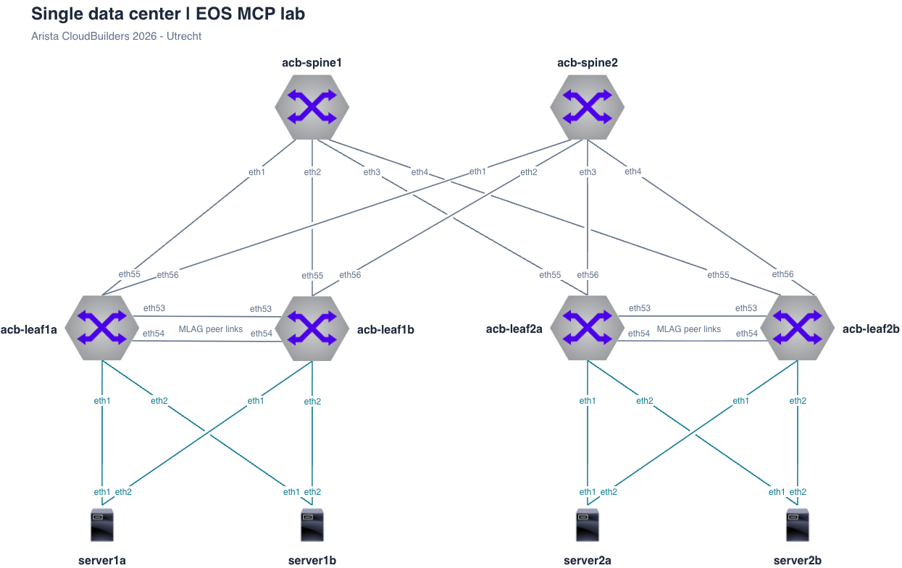

# Single DC to Test EOS MCP Server

A hands-on lab for **Arista CloudBuilders 2026 in Utrecht**, using Codex and the [EOS Model Context Protocol (MCP) server](https://github.com/aristanetworks/eos-mcp-server) to interact with an Arista EOS data center fabric.

The lab runs in Containerlab and consists of **two cEOS spines, four cEOS leaf switches, and four Linux servers**. The leaf switches form two MLAG pairs, with each leaf connected to both spines and each server dual-homed to its leaf pair. See the [Containerlab topology](clab/topology.clab.yml) for the node definitions and cabling.

## Take the lab home

Scan the QR code or [open the public repository](https://github.com/lbarros-arista/single-dc-l3ls) to download or clone the lab and try Codex with the EOS MCP server.

Follow the [Run the lab at home guide](RUN_LAB_AT_HOME.md) to set up your environment, start the lab, run checks, and stop it when finished.

<p align="center">
  <a href="https://github.com/lbarros-arista/single-dc-l3ls">
    
  </a>
</p>

## Contents

- [Single DC to Test EOS MCP Server](#single-dc-to-test-eos-mcp-server)
  - [Take the lab home](#take-the-lab-home)
  - [Contents](#contents)
  - [What is an MCP server?](#what-is-an-mcp-server)
  - [What are skills?](#what-are-skills)
    - [Network health checks](#network-health-checks)
    - [Troubleshooting](#troubleshooting)
    - [Validation](#validation)
    - [Visual reports](#visual-reports)
  - [Servers and tenant connectivity](#servers-and-tenant-connectivity)
    - [How the servers are built](#how-the-servers-are-built)
    - [Namespaces and addresses](#namespaces-and-addresses)
    - [Enter a namespace and test connectivity](#enter-a-namespace-and-test-connectivity)
  - [Run the lab at home](RUN_LAB_AT_HOME.md)
  - [Try it with Codex](#try-it-with-codex)
    - [Check device facts](#check-device-facts)
    - [Check BGP health](#check-bgp-health)
    - [Check EVPN health](#check-evpn-health)
    - [Follow a multicast stream](#follow-a-multicast-stream)
      - [1. Join the group on the receiver](#1-join-the-group-on-the-receiver)
      - [2. Send multicast from the other leaf pair](#2-send-multicast-from-the-other-leaf-pair)
      - [3. Ask Codex to investigate](#3-ask-codex-to-investigate)

> **Device login credentials:** see [aaa.yml](avd/group_vars/FABRIC/aaa.yml) for the configured usernames, roles, and comments documenting the lab passwords.

<p align="center">
  
</p>

## What is an MCP server?

An **MCP server** is a small program that gives an AI assistant tools to work with another system. **MCP** stands for **Model Context Protocol**: a shared way for AI assistants and tools to talk to each other. Think of the server as a bridge between the assistant and the system you want to explore.

In this lab, **Codex talks to the EOS MCP server**, and the server talks to the switches through **eAPI**, the EOS interface for software to run commands. For example, you can ask:

> Are all BGP neighbours up on the leaf switches?

Codex uses the server's tools to collect information from the switches, reads the results, and explains what it found. The EOS MCP server can read device information, run `show` commands, retrieve logs, test connectivity with pings, and collect packet captures. It does not change switch configuration.

> **Security note:** As a best practice, we use AAA (authentication, authorization, and accounting) with EOS roles to limit the server's credentials to the intended inspection and diagnostic commands. AI assistants may try other access methods, such as SSH, so these permissions should be enforced on the switches too. In this lab, [aaa.yml](avd/group_vars/FABRIC/aaa.yml) assigns the `mcp-reader` user to the `mcp` role. The role's permitted commands are defined under `custom_structured_configuration_roles` in [FABRIC.yml](avd/group_vars/FABRIC/FABRIC.yml#L50).

## What are skills?

A **skill** is a written, step-by-step guide for the AI assistant. It explains which information to collect, how to understand the results, and what to check next. The MCP server provides the tools, and the skills guide Codex through tasks such as checking BGP or investigating packet loss.

The overview below covers the **26 skills** in the EOS MCP server repository at [v0.13.1-beta](https://github.com/aristanetworks/eos-mcp-server/releases/tag/v0.13.1-beta). The skills are separate files in the repository, rather than part of the npm package. This lab's devcontainer makes them available to Codex from the host's EOS MCP server checkout. See the [upstream skills catalog](https://github.com/aristanetworks/eos-mcp-server/blob/main/skills/README.md) for the latest list and full instructions.

### Network health checks

These skills check whether network features are working and highlight possible problems.

| Skill | What it helps you check |
| --- | --- |
| [check-bgp-health](https://github.com/aristanetworks/eos-mcp-server/blob/main/skills/check-bgp-health/SKILL.md) | Whether BGP neighbours are connected and exchanging routes, including EVPN neighbours. |
| [check-evpn-health](https://github.com/aristanetworks/eos-mcp-server/blob/main/skills/check-evpn-health/SKILL.md) | Whether the EVPN/VXLAN fabric is learning devices and carrying traffic as expected. |
| [check-evpn-multicast-health](https://github.com/aristanetworks/eos-mcp-server/blob/main/skills/check-evpn-multicast-health/SKILL.md) | How the EVPN fabric delivers multicast traffic: traffic sent from one source to multiple receivers. |
| [check-interface-health](https://github.com/aristanetworks/eos-mcp-server/blob/main/skills/check-interface-health/SKILL.md) | Which ports are up or down, and whether they show errors, drops, or optical transceiver problems. |
| [check-port-channel-health](https://github.com/aristanetworks/eos-mcp-server/blob/main/skills/check-port-channel-health/SKILL.md) | Whether links bundled into a Port-Channel are working together correctly using LACP. |
| [check-vlan-health](https://github.com/aristanetworks/eos-mcp-server/blob/main/skills/check-vlan-health/SKILL.md) | Whether VLANs are active, have the expected ports, and have working routing interfaces. |
| [check-route-health](https://github.com/aristanetworks/eos-mcp-server/blob/main/skills/check-route-health/SKILL.md) | Routing tables and VRFs, the separate routing spaces used to keep networks apart. |
| [check-igmp-health](https://github.com/aristanetworks/eos-mcp-server/blob/main/skills/check-igmp-health/SKILL.md) | Whether switches know which ports have multicast receivers, using IGMP snooping. |
| [check-pim-health](https://github.com/aristanetworks/eos-mcp-server/blob/main/skills/check-pim-health/SKILL.md) | Whether routers have the PIM neighbours and routes needed to forward multicast traffic. |

### Troubleshooting

These skills follow a problem through several checks to help find its cause. The triage skills help choose where to start.

| Skill | What it helps you investigate |
| --- | --- |
| [multicast-triage](https://github.com/aristanetworks/eos-mcp-server/blob/main/skills/multicast-triage/SKILL.md) | A multicast problem where you need help choosing the right investigation. |
| [multicast-flow-missing](https://github.com/aristanetworks/eos-mcp-server/blob/main/skills/multicast-flow-missing/SKILL.md) | Multicast traffic that never reaches one or more receivers. |
| [multicast-flow-drops](https://github.com/aristanetworks/eos-mcp-server/blob/main/skills/multicast-flow-drops/SKILL.md) | Multicast traffic that arrives intermittently, freezes, or loses packets. |
| [multicast-flow-corrupt](https://github.com/aristanetworks/eos-mcp-server/blob/main/skills/multicast-flow-corrupt/SKILL.md) | Multicast traffic with symptoms such as broken audio or video, duplicate packets, or mixed streams. |
| [ptp-triage](https://github.com/aristanetworks/eos-mcp-server/blob/main/skills/ptp-triage/SKILL.md) | Clock synchronisation problems involving Precision Time Protocol (PTP). |
| [ptp-gm](https://github.com/aristanetworks/eos-mcp-server/blob/main/skills/ptp-gm/SKILL.md) | Why PTP selects the wrong main clock, called the grandmaster, or keeps changing it. |
| [ptp-debug](https://github.com/aristanetworks/eos-mcp-server/blob/main/skills/ptp-debug/SKILL.md) | Missing PTP messages, timing delays, and addressing or domain mismatches. |
| [troubleshoot-segment-routing](https://github.com/aristanetworks/eos-mcp-server/blob/main/skills/troubleshoot-segment-routing/SKILL.md) | Why ISIS Segment Routing paths, labels, or backup paths are not working. |
| [mcs-mounts](https://github.com/aristanetworks/eos-mcp-server/blob/main/skills/mcs-mounts/SKILL.md) | Switches that cannot fully connect or register with their MCS/CVX controllers. |
| [mcs-agents](https://github.com/aristanetworks/eos-mcp-server/blob/main/skills/mcs-agents/SKILL.md) | MCS software processes that crash, restart repeatedly, or stop responding. |

### Validation

These skills check whether a feature is configured or behaving as expected.

| Skill | What it helps you validate |
| --- | --- |
| [validate-segment-routing](https://github.com/aristanetworks/eos-mcp-server/blob/main/skills/validate-segment-routing/SKILL.md) | ISIS Segment Routing status, path identifiers, MPLS labels, and backup path protection. |
| [mcs-config-validate](https://github.com/aristanetworks/eos-mcp-server/blob/main/skills/mcs-config-validate/SKILL.md) | Whether MCS/CVX controllers and their connected switches have consistent settings. |
| [rfc-9721-validation](https://github.com/aristanetworks/eos-mcp-server/blob/main/skills/rfc-9721-validation/SKILL.md) | How EVPN tracks a host moving between leaf switches and detects duplicate addresses or repeated moves. You perform the host moves; the skill checks the results. |

### Visual reports

These skills save their findings as HTML reports that you can open in a browser.

| Skill | What it creates |
| --- | --- |
| [eos-fabric-report](https://github.com/aristanetworks/eos-mcp-server/blob/main/skills/eos-fabric-report/SKILL.md) | A fabric health dashboard showing topology, redundant links, and BGP status. |
| [eos-reachability-report](https://github.com/aristanetworks/eos-mcp-server/blob/main/skills/eos-reachability-report/SKILL.md) | Colour-coded ping results showing connectivity, packet loss, and response times across the fabric and tenant networks. |
| [eos-incident-report](https://github.com/aristanetworks/eos-mcp-server/blob/main/skills/eos-incident-report/SKILL.md) | A comparison of the network before, during, and after a fault that you introduce and recover from. |
| [eos-tenant-report](https://github.com/aristanetworks/eos-mcp-server/blob/main/skills/eos-tenant-report/SKILL.md) | An investigation of a tenant network, showing route exchange, VRF imports, return routes, and connectivity tests. |

You can ask Codex in everyday language, such as **"Check BGP health on all leaf switches"**, or name a skill directly: **"Use $eos-fabric-report to create a health dashboard for this lab."** Each skill applies to devices that use the relevant network feature.

## Servers and tenant connectivity

### How the servers are built

The four Linux servers use the same `lab-server:latest` image, built from Debian Bookworm Slim using [server/Dockerfile](server/Dockerfile). It includes tools such as `ping`, `traceroute`, `tcpdump`, and `iperf`. To build the image, run this command from the repository root in the devcontainer terminal:

```bash
make build-server-image
```

When Containerlab starts each server, it runs [setup-namespaces.sh](server/setup-namespaces.sh) with that server's host ID. The script joins `eth1` and `eth2` into an LACP bond called `bond0`, connecting the server to both leaves in its MLAG pair.

### Namespaces and addresses

Each server has ten **network namespaces**, named `ns-vlan10`, `ns-vlan20`, and so on up to `ns-vlan100`. A network namespace acts like a separate host: it has its own network interface, IP addresses, and routing table. For example, `ns-vlan10` contains the VLAN interface `bond0.10`.

All four servers have a namespace for every VLAN below. The switches place these VLANs into two separate tenant routing tables, called VRFs:

| Tenant / VRF | VLANs | Configuration |
| --- | --- | --- |
| RED | 10, 20, 30, 40, 50 | [RED.yml](avd/group_vars/TENANTS/RED.yml) |
| BLUE | 60, 70, 80, 90, 100 | [BLUE.yml](avd/group_vars/TENANTS/BLUE.yml) |

The [Containerlab topology](clab/topology.clab.yml) assigns each server a host ID. The tables below list every server's IPv4 address in every VLAN, grouped by tenant.

**RED tenant**

| Server   | Host ID | VLAN 10      | VLAN 20      | VLAN 30      | VLAN 40      | VLAN 50      |
| -------- | ------- | ------------ | ------------ | ------------ | ------------ | ------------ |
| server1a | 1       | `10.10.10.1` | `10.10.20.1` | `10.10.30.1` | `10.10.40.1` | `10.10.50.1` |
| server1b | 2       | `10.10.10.2` | `10.10.20.2` | `10.10.30.2` | `10.10.40.2` | `10.10.50.2` |
| server2a | 3       | `10.10.10.3` | `10.10.20.3` | `10.10.30.3` | `10.10.40.3` | `10.10.50.3` |
| server2b | 4       | `10.10.10.4` | `10.10.20.4` | `10.10.30.4` | `10.10.40.4` | `10.10.50.4` |

**BLUE tenant**

| Server   | Host ID | VLAN 60      | VLAN 70      | VLAN 80      | VLAN 90      | VLAN 100      |
| -------- | ------- | ------------ | ------------ | ------------ | ------------ | ------------- |
| server1a | 1       | `10.10.60.1` | `10.10.70.1` | `10.10.80.1` | `10.10.90.1` | `10.10.100.1` |
| server1b | 2       | `10.10.60.2` | `10.10.70.2` | `10.10.80.2` | `10.10.90.2` | `10.10.100.2` |
| server2a | 3       | `10.10.60.3` | `10.10.70.3` | `10.10.80.3` | `10.10.90.3` | `10.10.100.3` |
| server2b | 4       | `10.10.60.4` | `10.10.70.4` | `10.10.80.4` | `10.10.90.4` | `10.10.100.4` |

For any VLAN, the IPv4 address is `10.10.<VLAN>.<host-id>/24` and the default gateway is `10.10.<VLAN>.254`. The script also assigns IPv6 address `2001:db8:10:<VLAN>::<host-id>/64`, with gateway `2001:db8:10:<VLAN>::254`.

### Enter a namespace and test connectivity

Use `make login-server <server-suffix> <vlan>` from the repository root in the devcontainer terminal. The [Makefile](Makefile) opens a Bash shell inside the selected server's namespace using `docker exec` and `ip netns exec`.

For **RED**, enter VLAN 10 on **server1a**:

```bash
make login-server 1a 10
```

Inside the namespace, check the addresses and routes, then ping all 20 server IPv4 addresses in RED:

```bash
ip -br address
ip route
for vlan in 10 20 30 40 50; do
    for host_id in 1 2 3 4; do
        ping -c 1 -W 1 "10.10.${vlan}.${host_id}"
    done
done
exit
```

The `exit` command returns you to the devcontainer terminal. For **BLUE**, enter VLAN 60 on **server2a**:

```bash
make login-server 2a 60
```

Inside that namespace, ping all 20 server IPv4 addresses in BLUE:

```bash
for vlan in 60 70 80 90 100; do
    for host_id in 1 2 3 4; do
        ping -c 1 -W 1 "10.10.${vlan}.${host_id}"
    done
done
exit
```

With the fabric working, both checks should reach every server address in their respective tenant, across all five VLANs and both MLAG pairs.

## Try it with Codex

With the lab running, try these prompts in Codex. The `FABRIC` inventory group contains both spines and all four leaf switches, so you can ask Codex to check the whole fabric in one request.

### Check device facts

Start with an overview of the devices in your fabric and their basic system information:

```text
Use the EOS MCP server to check device facts for all devices in the FABRIC group.
Present the results in a table, with one row per device.
```

### Check BGP health

BGP lets the switches exchange routing information. Ask Codex to check that their BGP sessions are up:

```text
Use the EOS MCP server to check BGP Health on all devices in the FABRIC group.
Summarise neighbour states and highlight any sessions that are not Established.
```

An **Established** session means the BGP connection is up. If a session is down, ask Codex to explain the likely cause using the information it collected.

### Check EVPN health

Next, check the EVPN/VXLAN fabric that connects the tenant networks across the leaf pairs:

```text
Use the EOS MCP server to check EVPN Health on all devices in the FABRIC group.
Check the EVPN sessions, VXLAN state, VNI mappings, and learned MAC/IP routes.
Explain any problems you find in plain language.
```

This gives you a view of how the fabric learns where devices are connected and how their traffic can reach the other leaf pair.

### Follow a multicast stream

Multicast lets one sender deliver the same traffic to receivers that have joined a group. In this example, a receiver in **VLAN 50** joins group **226.94.1.1**, and a sender in **VLAN 10** sends traffic to that group from the other leaf pair. Both VLANs belong to **RED**, so the fabric must route multicast traffic between VLANs and carry it across the EVPN network.

| Role     | Server   | Namespace   | IPv4 address | Connected leaf pair       |
| -------- | -------- | ----------- | ------------ | ------------------------- |
| Sender   | server1a | `ns-vlan10` | `10.10.10.1` | acb-leaf1a and acb-leaf1b |
| Receiver | server2a | `ns-vlan50` | `10.10.50.3` | acb-leaf2a and acb-leaf2b |

Open two terminals in the devcontainer, both at the repository root. The server image already includes `iperf`, the tool we use to generate and receive the stream.

#### 1. Join the group on the receiver

In the first terminal, enter VLAN 50 on **server2a**:

```bash
make login-server 2a 50
```

Inside the namespace, start the receiver:

```bash
iperf -s -u -B 226.94.1.1 -i 1
```

This joins the multicast group and waits for UDP traffic. Leave it running while you start the sender.

#### 2. Send multicast from the other leaf pair

In the second terminal, enter VLAN 10 on **server1a**:

```bash
make login-server 1a 10
```

Inside the namespace, start the stream:

```bash
iperf -c 226.94.1.1 -u -T 32 -t 200 -i 1
```

The sender transmits UDP traffic for **200 seconds**, with a report every second. `-T 32` sets the multicast time-to-live (TTL) to 32, allowing the traffic to cross routers. The receiver should start reporting received traffic; use its output to confirm delivery.

#### 3. Ask Codex to investigate

While the stream is running, try this prompt with the [EVPN multicast health skill](https://github.com/aristanetworks/eos-mcp-server/blob/main/skills/check-evpn-multicast-health/SKILL.md):

```text
Use $check-evpn-multicast-health to inspect multicast group 226.94.1.1 in VRF RED
on acb-leaf1a, acb-leaf1b, acb-leaf2a, and acb-leaf2b.
The sender is server1a in VLAN 10, source IP 10.10.10.1.
The receiver is server2a in VLAN 50, receiver IP 10.10.50.3.
Check whether the receiver has joined the group, inspect the EVPN multicast
routes and forwarding state, and explain how the traffic reaches the receiver.
Highlight any missing state or evidence you could not collect.
```

This gives Codex a concrete flow to investigate using the EOS MCP server. Compare its findings with the traffic reports in the receiver terminal.

The sender stops automatically after 200 seconds. Press **Ctrl+C** to stop the receiver, or to stop the sender early, then type `exit` in each namespace shell to return to the devcontainer terminal.
